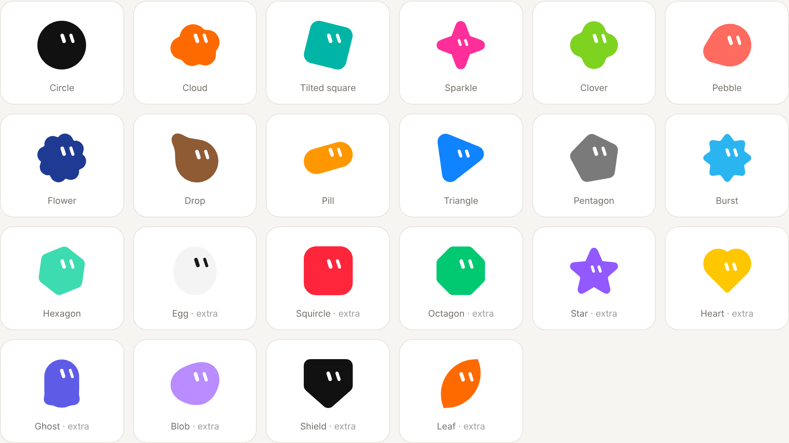
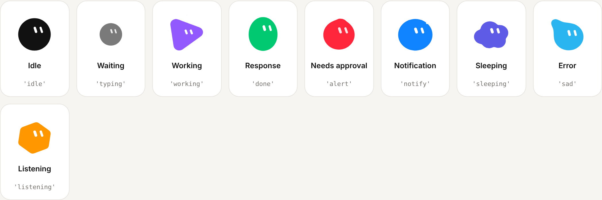
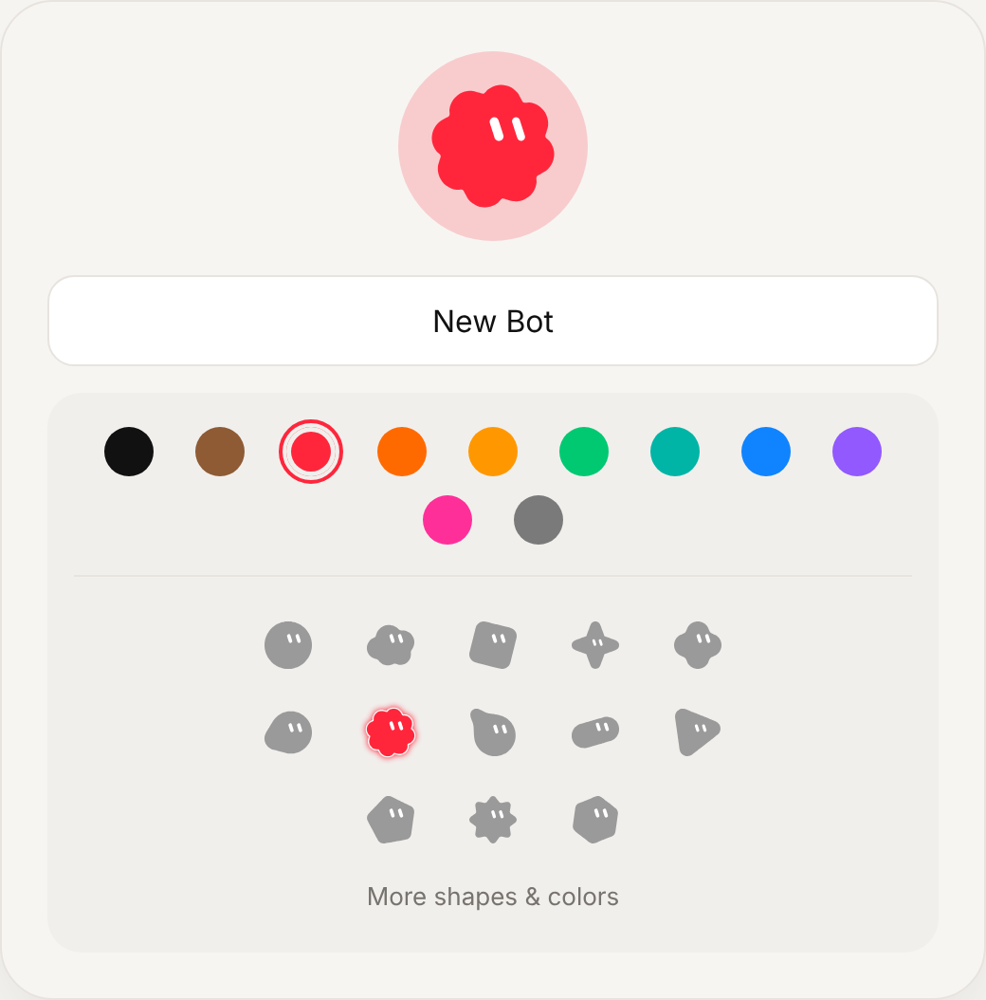

# Grok Bot Characters

A recreation of the animated **Grok Bot** characters in code: the little colored blobs with two slanted white eyes that the Grok Bot beta uses as avatars for each bot or project.

Open `index.html` in a browser. There is no build step and there are no dependencies.



## What's in here

| | |
|---|---|
| `src/grokbot.js` | The character library (about 700 lines of vanilla JS, rendered as SVG) |
| `index.html` | Demo page: an interactive bot with state and action controls, a copy of the "New Bot" picker, every state, every shape, and a sidebar and thread mockup |
| `docs/` | Preview images |

## Research notes

What the source material shows (the Grok Bot beta launch from Aug 2026, the "Meet Grok Bot" site, and design lead Benji Taylor's clip *"Had a lot of fun animating our new Grok Bot icon. It's entirely made with code"*):

- **Body:** a flat, solid shape with no outline or shading. The defaults are a circle and a black body.
- **Eyes:** two white, rounded vertical pills, tilted about 20° (the top leans left). They sit up and to the right of center, so the bot looks like it is glancing up. When the eyes move toward the rim they foreshorten, as if drawn on a sphere.
- **Shapes and colors:** the "New Bot" dialog has **11 colors** (black, brown, red, tangerine, orange, green, teal, blue, purple, pink, gray) and **13 shapes** (circle, cloud, tilted square, sparkle, clover, pebble, flower, drop, pill, triangle, pentagon, burst, hexagon).
- **States:** the app describes three, *Wait*, *Work* and *Response*, and each one "transforms into a different shape without interruption":
  - **Wait:** the bot shrinks into the middle of three pulsing typing dots, then grows back out of it.
  - **Work:** the bot cycles through shapes (egg, hexagon, triangle, circle…) while rainbow orbit trails sweep around it in 3D, passing in front of and behind the body.
  - **Response:** the bot springs back with a squash-and-stretch bounce.
- **Other moments in the footage:** blinks, sideways looks and a wink (one eye stays a pill while the other becomes a line). Approval requests turn the bot into a **"!"** (the body stretches into the bar and the dot pops out underneath). Notifications add a blue badge and switch to round, wide eyes. The bot also spits out a little dot, and pops in from a single dot.

## What was recreated

- **22 shapes**: the 13 picker shapes plus 9 extras (egg, squircle, octagon, star, heart, ghost, blob, shield, leaf).
- **20 colors**: the 11 picker colors plus 9 extras (yellow, lime, sky, indigo, coral, mint, lavender, navy, white). Light bodies automatically get dark eyes.
- **9 states**: `idle`, `typing` (Wait), `working` (Work), `done` (Response), `alert` ("!"), `notify`, `sleeping`, `sad`, `listening`.
- **Actions**: `blink(double)`, `wink()`, `bounce()`, `spit()`, `surprise()`, `shake()`, `spin(dir, { turns, dur, tilt })`, `intro()`, `look(x, y)`, `morph(shape)`.
- **3D spin**: the spin rolls the bot head over heels toward you, as in the footage, rather than turning it like a flat disc. The body stays solid while the eyes swell on the way down, slide off the bottom edge, stay hidden while the back is showing, then come back over the top. The working state does this tumble between shape changes.
- **8 expressions**: `normal`, `happy`, `squint`, `surprised`, `round`, `sleepy`, `sad`, `focused`.
- **Idle behavior**: random blinks (sometimes double), glances, and occasional mischief such as spits, bounces and winks. The bot can optionally follow the pointer with its eyes.



## How it works

Each shape is a **signed distance function**: circles, rounded polygons and stars, capsules, smooth unions of circles, and a heart. At load time each SDF is sampled into a ring of 72 points by casting rays from the center. Every shape has the same number of points, so any shape morphs into any other by moving point *i* to point *i*. Each point is a damped spring, which gives the jelly-like wobble. The outline is drawn as a closed Catmull-Rom spline.

For the 3D spin, the body stays a solid shape, as in the footage. During the roll it sways a little in-plane, compresses slightly along the roll axis, and leans toward the viewer. The eyes carry the 3D: they are points on a sphere under the face, rolled around a slightly tilted horizontal axis. They swell to about twice their size on the way down, flatten and slide off the bottom edge (they are clipped to the body), stay hidden while the back is showing, then come back over the top.

Squash, bounce, eye position, eye size, blinks, the badge and the "!" dot are all springs too. A single shared `requestAnimationFrame` loop drives every bot on the page, and bots that scroll off-screen pause through an `IntersectionObserver`.

## Usage

```html
<div id="me"></div>
<script src="src/grokbot.js"></script>
<script>
  const bot = new GrokBot(document.getElementById('me'), {
    shape: 'flower',      // see GrokBot.SHAPE_NAMES
    color: 'red',         // a palette name or any hex color
    size: 64,             // px
    followPointer: true,  // eyes track the cursor
  });

  bot.setState('working');           // idle | typing | working | done | alert | notify | sleeping | sad | listening
  setTimeout(() => bot.setState('done'), 3000);
  bot.setShape('hexagon');            // morphs
  bot.setColor('#00C972');
  bot.spit();
</script>
```

Static export (no animation), for example for favicons:

```js
GrokBot.toSVG('cloud', 'blue', 128); // -> '<svg ...>...</svg>'
```

The library also loads as CommonJS (`require('./src/grokbot.js')`) for `toSVG` and the shape data.



---

An independent fan recreation for learning and design study. It is not affiliated with xAI or Grok, and no original assets are used: every shape and animation is reimplemented from scratch.
